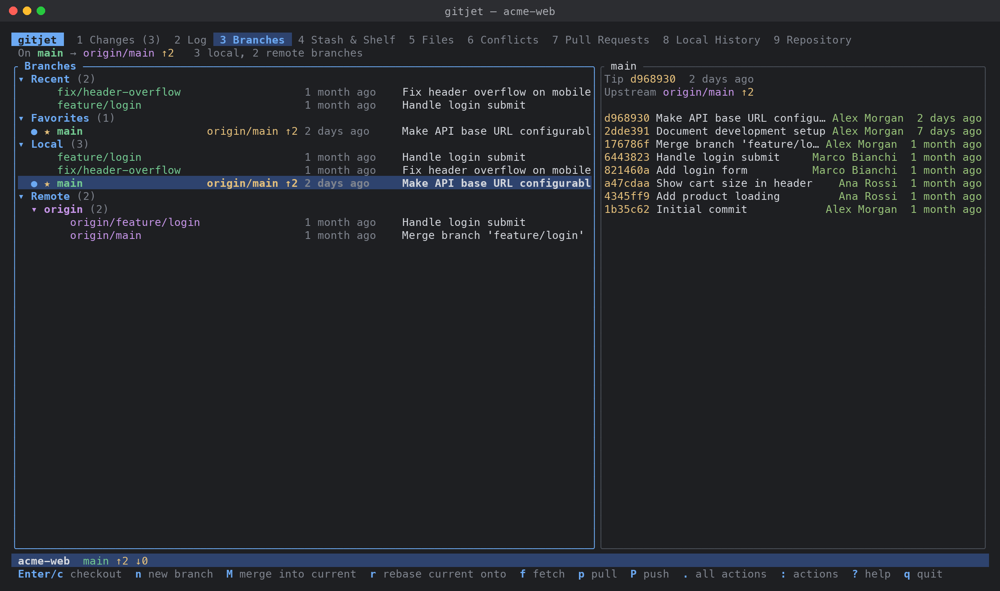

[← Back to docs index](README.md)

# Branches and remotes

The **Branches** tab (tab `3`) lists your branches and has every branch and remote operation:
checkout (including smart checkout), new branch, rename, delete, merge into the current branch,
rebase the current branch onto another, check out and rebase onto the current branch, compare
with the current branch, upstream tracking, Fetch, Pull, Update Project and the Push dialog.

## The screen

- **Header line**: the current branch and its upstream with ahead/behind counts (`↑2 ↓1`,
  `(up to date)`, `(gone on the remote)` or `(no upstream)`), or `HEAD detached at <hash>`. While a
  merge, rebase, cherry-pick and so on is in progress, its state (for example `REBASING`) is shown
  too, followed by the number of local and remote branches.
- **Branches tree** (left). Four sections, each hidden when empty:
  - **Recent**: up to five local branches you checked out recently (read from the HEAD reflog), not
    including the current one.
  - **Favorites**: branches you starred. `main` and `master` are favorites until you change the list.
  - **Local**: all local branches.
  - **Remote**: remote-tracking branches, grouped by remote.

  Each row shows `●` for the current branch, `★` for a favorite, the name, the upstream with
  ahead/behind (`origin/main ↑1 ↓2`, or `origin/x (gone)` when the remote branch was deleted), the
  age of the tip commit and its subject.
- **Branch details** (right, only when the window is at least 100 columns wide): the tip commit,
  the upstream of a local branch, how many commits the branch is ahead of and behind the current
  branch (counted in the background once the selection rests), and the last 100 commits of the
  branch.

The tab title shows a badge such as `↓3` when the current branch is behind its upstream.

## How to check out a branch

1. Select the branch and press `Enter` (or `c`).
2. For a **remote** branch gitjet asks for the name of the local branch, prefilled with the remote
   branch's short name. If a local branch of that name already exists, `Enter` checks it out; type
   another name to create a new local branch tracking the remote one.
3. If your local changes would be overwritten, a menu opens:
   - **Smart checkout (stash, checkout, unstash)** (`s`): stashes your tracked changes, checks out the
     branch and re-applies the stash. If re-applying conflicts, the stash entry is kept and gitjet
     switches to the [Conflicts](conflicts.md) tab. This entry is only offered when no untracked
     files are in the way.
   - **Show the N untracked file(s) in the way** (`v`): lists untracked files that the target branch
     tracks. Stashing cannot help with these; move or remove them, or force the checkout.
   - **Force checkout (discard local changes)** (`f`): asks for confirmation, listing the files whose
     changes will be lost (and the untracked files that will be overwritten), then runs
     `git checkout -f`.
   - **Cancel**.

From anywhere, the action palette entry **Checkout branch…** opens a filterable list of all
branches.

## How to create a branch

1. Select the branch to start from (or a section header to start from `HEAD`) and press `n`.
2. Type the **Branch name**. For a remote start point the name is prefilled with its short name.
3. `Tab` moves between the name and two checkboxes; `Space` toggles them:
   - **Checkout branch** (on by default).
   - **Overwrite existing branch**: resets an existing branch of that name to the start point
     (`git checkout -B` / `git branch -f`). If that would leave commits reachable only from the
     reflog, gitjet asks first and shows the old tip and the command to restore it.
4. Press `Enter`. Names are checked with `git check-ref-format --branch`; errors are shown inside the
   dialog.

## How to rename, delete and favorite branches

- **Rename** (`R`): local branches only. The favorite mark follows the new name.
- **Delete** (`D`):
  - A local branch is deleted with `git branch -d`. If it is not fully merged, gitjet asks whether to
    force-delete it (`git branch -D`) and shows its tip hash so you can recover it from the reflog.
  - The current branch cannot be deleted.
  - For a remote branch, gitjet asks for confirmation and then runs `git push <remote> --delete
    <branch>` in the background.
- **Favorite** (`*`): toggles the star. Favorites are stored per repository in
  `.git/gitjet/favorites.json`.

## How to merge a branch into the current one

1. Select the branch and press `M` (it must not be the current branch).
2. Choose a flavor:

   | Key | Menu item | Runs |
   |---|---|---|
   | `m` | Merge | `git merge --no-edit --autostash <branch>` |
   | `n` | Merge (--no-ff, always create a merge commit) | adds `--no-ff` |
   | `s` | Squash merge (stage changes, commit yourself) | adds `--squash`; commit afterwards in the [Changes](changes-and-commit.md) tab |
   | `f` | Fast-forward only | adds `--ff-only` |

Uncommitted changes are stashed and restored automatically (`--autostash`). If the merge stops on
conflicts, gitjet switches to the [Conflicts](conflicts.md) tab.

## How to rebase

- **Rebase the current branch onto the selected one** (`r`): runs `git rebase --autostash <branch>`
  right away.
- **Check out the selected branch and rebase it onto the current one** (`C`): runs `git rebase --autostash <current> <branch>`. Only for local branches
  other than the current one.

When a rebase stops on conflicts, gitjet switches to the [Conflicts](conflicts.md) tab. To reorder,
squash or reword commits, use the [interactive rebase editor](interactive-rebase.md).

## How to compare branches

- **Compare with current** (`=`): a dialog with two lists, *In <branch> but not in <current>* and
  *In <current> but not in <branch>* (up to 1000 commits each). `Enter` opens the selected commit's
  diff, and `d` shows the changes on the branch since it diverged from the current branch (the diff
  from the merge base to the branch).
- **Show diff with working tree** (`w`): opens the [diff viewer](diff-viewer.md) with the
  differences between the branch and your working tree.

## How to set the upstream

Select a local branch and press `u`. A filterable list of all remote-tracking branches opens (the
current upstream is marked `(current)`); choose one to run `git branch --set-upstream-to`. If the
branch already has an upstream, the first entry is **Unset upstream (currently …)**.

## How to fetch, pull and update the project

All three run in the background with a spinner in the status bar and a summary toast when done.

- **Fetch** (`f`): `git fetch --all --tags`, plus `--prune` when `update.prune` is `true` (the
  default). The toast reports how many remote branches were updated, created or pruned, and whether
  the current branch is now behind.
- **Pull** (`p`): opens a menu for the current branch:

  | Key | Menu item | Runs |
  |---|---|---|
  | `m` | Pull, merge | `git pull --no-edit --autostash --no-rebase` |
  | `r` | Pull, rebase | `git pull --no-edit --autostash --rebase` |
  | `f` | Pull, fast-forward only | `git pull --no-edit --autostash --ff-only` |
  | `t` | Pull (in terminal) | see [below](#credential-and-ssh-prompts-the-in-terminal-actions) |

  Pull needs an upstream; set one with `u` or push with *Set upstream*.
- **Update Project** (`U`): fetches all remotes (as Fetch does), then, if
  the current branch has an upstream with new commits, integrates them with
  `git rebase --autostash @{upstream}` or `git merge --no-edit --autostash @{upstream}`. The
  method comes from `update.method` in the [configuration](configuration.md) (`"rebase"`, the
  default, or `"merge"`).

If a pull or update stops on conflicts, the error tells you how many files conflict; resolve them
in the [Conflicts](conflicts.md) tab.

## How to push

Press `P` (or use **Push…** from the action palette). With the current branch selected (or no
branch selected) this opens the **Push Commits** dialog:

- The header shows `local → remote/target`, with a `NEW` badge when the branch does not exist on
  the remote yet. The target is the branch's upstream; without one it is a branch of the same name
  on `origin` (or the first remote) with *Set upstream* ticked.
- **Commits to push** lists the commits the push will send (up to 1000 are listed), and **Files**
  lists the files changed by the selected commit. `Enter` opens the diff of the commit, or of the
  selected file.
- Options: **Force with lease** (`f`), **Push tags** (`t`), **Set upstream** (`u`).
- `R` changes the target: pick the remote (when there are several), then type the branch name on the
  remote.
- `p` or `Ctrl+S` pushes (or `Enter` on the Push button). With *Force with lease* ticked gitjet asks
  for confirmation first; the push is refused by Git if the remote changed since your last fetch.
  If there is nothing to push, gitjet says so and does nothing.

The push runs in the background with `git push --porcelain [--force-with-lease] [--tags]
[--set-upstream] <remote> refs/heads/<local>:refs/heads/<target>`.

Pressing `P` on a local branch that is **not** the current one pushes it straight away in the
background, to its upstream or, without one, to a new branch of the same name with set-upstream.

## Credential and SSH prompts: the "(in terminal)" actions

Background Git never asks questions on the terminal gitjet is using: it runs with
`GIT_TERMINAL_PROMPT=0`, and SSH runs in batch mode (`-o BatchMode=yes` is added to the SSH command
unless you use `GIT_SSH`, PuTTY's plink, or already set `BatchMode`). When a fetch, pull or push fails
because Git needs a username, password, SSH passphrase or host-key confirmation, the error message
points you to the matching "(in terminal)" action.

These actions leave the TUI, run a plain `git` command in your real terminal in the repository root
so that prompts work, and return to gitjet when it finishes (a non-zero exit code is shown as a
toast; every view refreshes):

| Action | Runs |
|---|---|
| Fetch (in terminal) | `git fetch --all --tags` (plus `--prune` when `update.prune` is on) |
| Pull (in terminal) | `git pull --autostash --rebase`, or `--no-rebase` when `update.method = "merge"` |
| Push (in terminal) | `git push [--set-upstream] <remote> refs/heads/<branch>:refs/heads/<target>` for the current branch, with the same target the push dialog would use |

They are in the action palette (`:`), in the Branches context menu (`.` or `m`), and *Pull (in
terminal)* is also `t` in the Pull menu. A credential helper (see
[Troubleshooting](troubleshooting.md)) lets background operations work without prompts after the
first successful login.

## Keys

### Branches tab

Keys that act on a branch work in both panes and use the branch selected in the tree.

| Key | Action |
|---|---|
| `↑` `↓` / `j` `k` | Move |
| `PgUp` `PgDn` | Page up / down |
| `Home` / `g`, `End` / `G` | First / last row |
| `Enter` | On a branch: checkout. On a section or remote header: collapse / expand |
| `Space` | On a section or remote header: collapse / expand |
| `←` / `h` | On a header: collapse. On a branch: jump to its header |
| `→` / `l` | On a header: expand. On a branch: focus the branch commits pane |
| `Tab` / `Shift+Tab` | Focus the branch commits pane |
| `/` | Filter branches by name (every word must match, case-insensitive) |
| `Esc` | Clear the filter |
| `c` | Checkout |
| `n` | New branch from the selected branch (from `HEAD` on a header) |
| `C` | Checkout the selected branch and rebase it onto the current one |
| `M` | Merge the selected branch into the current one (menu) |
| `r` | Rebase the current branch onto the selected one |
| `=` | Compare with the current branch |
| `w` | Show diff with working tree |
| `u` | Set or unset upstream |
| `P` | Push (dialog for the current branch; background push for another local branch) |
| `R` | Rename |
| `D` | Delete |
| `*` | Add to / remove from favorites |
| `f` | Fetch all remotes |
| `p` | Pull (menu) |
| `U` | Update project |
| `.` / `m` | Context menu |
| Mouse click | Select a row, or focus the commits pane |

While typing a filter: `Enter` keeps the filter and returns to the list, `Esc` clears it, `↑` `↓`
move the selection.

### Branch commits pane

| Key | Action |
|---|---|
| `↑` `↓` / `j` `k` | Move |
| `PgUp` `PgDn` | Page up / down |
| `Home` / `g`, `End` / `G` | First / last commit |
| `Enter` | Show the commit's diff |
| `Esc` / `Tab` / `Shift+Tab` / `←` / `h` | Back to the branches tree |

The branch keys of the table above (`c`, `n`, `M`, `P`, `.` …) also work here.

### Branch context menu (`.` / `m`)

| Key | Menu item | Available for |
|---|---|---|
| `c` | Checkout / Checkout as new local branch tracking *remote/branch*… | Branches other than the current one |
| `n` | New branch from *branch*… | All |
| `C` | Checkout and rebase onto *current* | Local branches other than the current one |
| `=` | Compare with *current* | Branches other than the current one |
| `w` | Show diff with working tree | All |
| `r` | Rebase *current* onto *branch* | Branches other than the current one |
| `M` | Merge *branch* into *current*… | Branches other than the current one |
| `P` | Push… | Local branches |
| `R` | Rename… | Local branches |
| `u` | Set upstream… | Local branches |
| `*` | Add to favorites / Remove from favorites | All |
| `D` | Delete / Delete *branch* on the remote… | Branches other than the current one |
| `f` | Fetch all remotes | Always |
| `p` | Pull… | Always |
| `U` | Update project | Always |
| | Fetch (in terminal) | Always |
| | Pull (in terminal) | Always |
| | Push (in terminal) | Always |

On a section header the menu offers **New branch from HEAD…** (`n`) and the network entries.

### Checkout blocked by local changes

| Key | Menu item |
|---|---|
| `s` | Smart checkout (stash, checkout, unstash) |
| `v` | Show the N untracked file(s) in the way |
| `f` | Force checkout (discard local changes) |
| `Esc` | Cancel |

### New branch dialog

| Key | Action |
|---|---|
| `Enter` | Create |
| `Tab` / `↓` | Next field |
| `Shift+Tab` / `↑` | Previous field |
| `Space` | Toggle the focused checkbox |
| `Esc` | Cancel |

### Merge menu

| Key | Menu item |
|---|---|
| `m` | Merge |
| `n` | Merge (--no-ff, always create a merge commit) |
| `s` | Squash merge (stage changes, commit yourself) |
| `f` | Fast-forward only |

### Pull menu

| Key | Menu item |
|---|---|
| `m` | Pull, merge |
| `r` | Pull, rebase |
| `f` | Pull, fast-forward only |
| `t` | Pull (in terminal) |

### Compare dialog

| Key | Action |
|---|---|
| `↑` `↓` / `j` `k` | Move |
| `PgUp` `PgDn` | Page up / down |
| `Home` / `g`, `End` / `G` | First / last commit |
| `Tab` / `Shift+Tab` / `←` `→` / `h` `l` | Switch list |
| `Enter` | Show commit diff |
| `d` | Diff from the merge base to the branch |
| `r` | Reload |
| `Esc` / `q` | Close |

### Push dialog

| Key | Action |
|---|---|
| `p` / `Ctrl+S` | Push |
| `Enter` | Show diff of the selected commit or file; on the Push button: push |
| `Tab` / `Shift+Tab` | Next / previous pane (commits, files, Push button) |
| `↑` `↓` / `j` `k` | Move in the focused list |
| `PgUp` `PgDn` | Page up / down |
| `Home` / `g`, `End` / `G` | First / last |
| `f` | Toggle force with lease |
| `t` | Toggle push tags |
| `u` | Toggle set upstream |
| `R` | Change target remote and branch |
| `Esc` / `q` | Cancel |

The upstream chooser and the palette's branch pickers are filterable menus: type to filter, `↑`
`↓` to move, `Enter` to choose, `Esc` to close.

## Action palette

Entries added by this area (press `:` and type to search):

- Fetch
- Pull…
- Update Project
- New branch…
- Checkout branch…
- Merge branch…
- Rebase onto…
- Delete branch…
- Rename branch…
- Compare with branch…
- Fetch (in terminal)
- Pull (in terminal)
- Push (in terminal)
- Push…

The entries ending in `…` that take a branch first open a filterable branch list.
