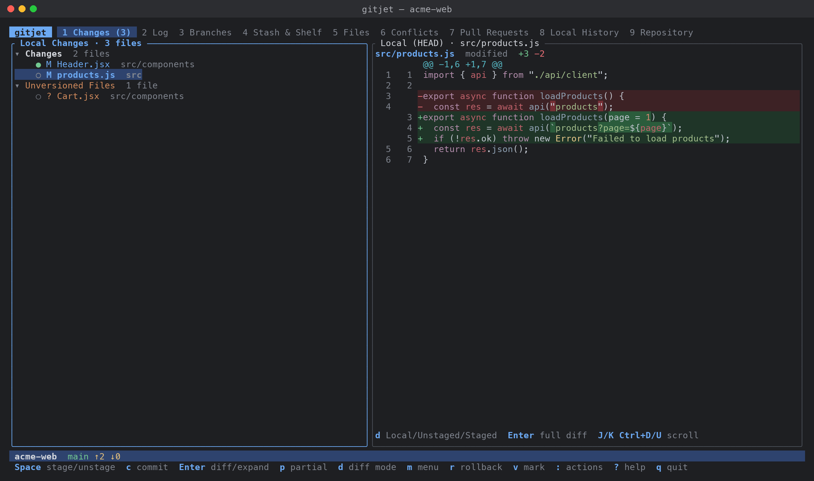
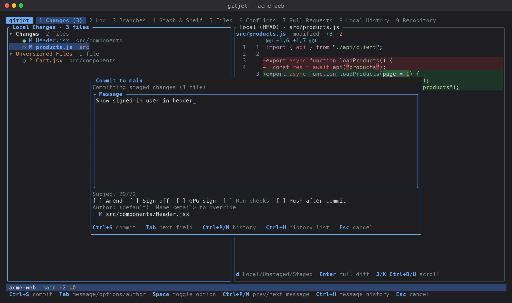

[← Back to docs index](README.md)

# Changes and commit

The **Changes** tab (key `1`) is where you prepare commits: your uncommitted files grouped by **changelist**, a diff preview, staging of whole files or
single lines, and the **commit dialog** with message history, amend, sign-off, signing, author
override, commit checks and "commit and push".



## The screen

The left pane (Local Changes) lists every changed file. The right pane previews the diff of the
selected file.

Files are grouped under these headers:

| Group | Contents |
|---|---|
| Merge Conflicts | Conflicted files. Shown first, only when there are conflicts. |
| One header per changelist | Tracked changed files assigned to that changelist. The default list is called `Changes`. The active list is marked `(active)` when there is more than one list. |
| Unversioned Files | Untracked files. Shown last. |

Each file row shows:

| Mark | Meaning |
|---|---|
| `▪` | The file is marked (see [Marking files](#mark-several-files)) |
| `●` | Fully staged |
| `◐` | Partially staged (staged and unstaged changes) |
| `○` | Not staged |
| `!` | Conflict |
| `M` `A` `D` `R` `C` `T` `?` `U` | Modified, added, deleted, renamed, copied, type changed, untracked, conflicted |
| `← old/path` | Original path of a rename |
| `(both modified)` etc. | Kind of conflict |
| `[submodule]` | The entry is a submodule |

The tab title shows the number of changed files, for example `Changes (3)`.

The preview has three modes, switched with `d`:

| Mode | Shows |
|---|---|
| Local (HEAD) | Work tree compared with the last commit |
| Unstaged | Work tree compared with the index |
| Staged | Index compared with the last commit |

The preview shows at most 4000 diff lines and says `(preview truncated)` when it cuts something.
Press `Enter` to open the full [diff viewer](diff-viewer.md).

## Which files an action applies to

- If you have **marked** files, actions apply to the marked files.
- Otherwise they apply to the selected row: a file, a directory (in tree mode) with everything under
  it, or a group header with all of its files.

## How to stage and unstage

1. Select a file, a directory or a group header.
2. Press `Space`. If everything in the selection is already fully staged, `Space` unstages it;
   otherwise it stages it.

- `a` stages all changes, `A` unstages all changes.
- `Space` on an unversioned file adds it to Git (stages it).
- `Space` on a conflicted file stages it, which marks the conflict as resolved.
- Up to 16 files are staged immediately; larger selections run in the background with a spinner.

## How to stage or unstage single lines or hunks

This lets you commit part of a file: only the lines you select.

1. Select a file and press `p` (or `e`). The **Partial** screen opens full-screen. It shows the
   unstaged changes, or the staged changes when the file has nothing unstaged.
2. Move with `j`/`k`. Press `Space` on a changed line to select it, or on a hunk header to select the
   whole hunk. `H` selects the hunk under the cursor, `a` selects everything, `c` clears the
   selection.
3. Press `s` to stage the selected lines (unstaged view) or `u` to unstage them (staged view). Press
   `d` or `Tab` to switch between the unstaged and the staged view.
4. Press `Esc` to close.

If nothing is selected, `s`, `u` and `x` act on the line under the cursor, or on the whole hunk when
the cursor is on a hunk header. Line markers are `[ ]` and `[x]`; hunk headers show `[ ]`, `[▪]` (some
lines selected) or `[■]` (all lines selected).

Partial staging works for untracked files too. It is not available for binary files, submodules or
conflicted files.

You can also open it from the action palette: **Partial stage file…** shows a searchable list of
changed files.

## How to discard selected lines

1. Open the Partial screen with `p` and make sure it shows the unstaged changes (`d` switches).
2. Select lines with `Space` or a hunk with `H`.
3. Press `x` and confirm. The lines are removed from the work tree. This cannot be undone (but see
   [Local History](local-history.md)).

## How to commit

1. Decide what to commit. The commit dialog takes, in this order:
   - the **staged changes**, if anything is staged;
   - otherwise the **marked files**;
   - otherwise the files of the **changelist** the selection belongs to (the active changelist when
     the selection is in Merge Conflicts or Unversioned Files). Unversioned and conflicted files are
     not included in this case.
2. Press `c`. The dialog title says where the commit goes (`Commit to main`, `Initial commit`,
   `Commit (detached HEAD)`) and the first line says what is committed, for example
   `Committing staged changes (1 file)`.
3. Type the message. `Enter` starts a new line.
4. Press `Ctrl+S` (or `Alt+Enter`) to commit.

When you commit marked files or a changelist, gitjet commits exactly those paths
(`git commit --only`), adding any marked unversioned files first. Other staged content is not
touched. With no commit checks and no push, the dialog closes at once and the commit runs in the
background.



### Commit options

Press `Tab` to move between the message, the options row and the author field. In the options row,
move with `←`/`→` (or `h`/`l`) and toggle with `Space` or `Enter`, or press the option's letter:

| Letter | Option | Effect |
|---|---|---|
| `a` | Amend | Amend the last commit (`--amend`). Turning it on loads the last commit's message; turning it off restores your previous text if you did not edit it. Disabled when there are no commits yet. With nothing to commit, amend changes only the message. |
| `s` | Sign-off | Add a `Signed-off-by` trailer (`--signoff`). Default from `commit.sign_off`. |
| `g` | GPG sign | Sign the commit (`-S`, using your Git signing setup). When off, gitjet passes `--no-gpg-sign`. On by default when `commit.gpg_sign` is `true` in gitjet's config or `commit.gpgsign` is true in your Git config. |
| `c` | Run checks | Run the configured commit checks first. Shows the number of checks; disabled when none are configured. |
| `p` | Push after commit | Open the push dialog after a successful commit. |

**Author**: leave empty to use your Git identity, or type `Name <email>` to override it
(`--author`). `Enter` in the author field returns to the message.

The line under the message shows `Subject n/limit`. When the first line is longer than
`commit.subject_limit` (default 72) it turns to the warning color. A limit of `0` turns the warning
off.

### Commit message history

- `Ctrl+P` / `Ctrl+N` step to the previous / next message you committed. Stepping past the newest
  brings back what you were typing.
- `Ctrl+H` (or `Ctrl+R`) opens a searchable list of previous messages.

gitjet keeps the last 50 messages per repository.

### Drafts

If you close the dialog with `Esc` after typing a message, the text is kept as a draft and comes back
the next time you open the dialog. The draft is cleared after a successful commit.

### Commit checks

Commit checks are your own commands, run before the commit (for example tests or a linter).
Define them in the [configuration](configuration.md) file:

```toml
[[commit.checks]]
name = "Tests"
command = "cargo test"
# enabled = true      # set to false to hide the check from the commit dialog
```

How they run:

- Every check with `enabled = true` and a non-empty command is used. A check without a `name` is
  shown by its command.
- They run one after another through the platform shell (`cmd /C` on Windows, `sh -c` elsewhere) in
  the repository root, without a terminal for input.
- While they run the dialog shows `Running commit checks…`. Press `Esc` to hide the dialog; the job
  keeps running in the background.
- If any check exits with a non-zero status, the dialog shows **Commit checks failed** with the
  output of every check. Press `c` to **commit anyway**, or `e`/`Esc` to go back to the message.
- If all checks pass, the commit is made and the dialog closes.

### Commit and push

Press `C` in the Changes tab (or turn on **Push after commit** in the dialog). After the commit
succeeds the [push dialog](branches-and-remotes.md) opens. If you hide the commit dialog with `Esc`
while the commit is running, the push is not started and the result message says so.

### Amend the last commit

Use the action palette (`:`) entry **Amend last commit…**, or press `c` and turn on **Amend** with
`Tab` then `a`.

## How to work with changelists

Changelists are named groups of changed files. Exactly one list is **active**: newly
changed files go to it. Files that are no longer changed are dropped from their list automatically.
The first list (initially `Changes`) is the default list: it can be renamed but not deleted.

| Task | How |
|---|---|
| Create a list | `n`, type a name. Marked files move into the new list. |
| Move files to another list | Select or mark files, press `M`, pick the list (number keys `1`-`9` work, or **New changelist…** with `n`). Unversioned files have no changelist and cannot be moved. |
| Rename a list | Select its header, press `R`. |
| Describe a list | Select its header, press `E`. The description is shown next to the name. |
| Make a list active | Select its header (or a file in it), press `*`, confirm. |
| Delete a list | Select its header, press `X`, confirm. Its files move to the default list. |
| Commit a list | Select the list or a file in it, make sure nothing is staged, press `c`. |

Changelists are stored in `.git/gitjet/changelists.json` (`changelists.<worktree>.json` for a linked
worktree). If the file is damaged, gitjet moves it aside to `changelists.json.bak` (or
`changelists.json.N.bak`), starts with a fresh default list, and shows a notice above the list until
you press `Esc`.

## How to roll back changes

1. Select or mark files (or select a changelist or directory).
2. Press `r` and confirm.

Rollback restores tracked files to their last committed state (index and work tree), removes added
files from the index and the disk, undoes renames, checks conflicted files out from `HEAD`, and
**deletes unversioned files** in the selection. The confirmation lists the files and says how many
unversioned files will be deleted.

**Rollback all…** in the action palette rolls back every tracked change and keeps unversioned files.

## How to handle unversioned files

- `Space` adds them to Git.
- `i` adds them to the root `.gitignore`. With one file (or one directory row in tree mode) you can
  edit the pattern first; it is root-anchored, for example `/build/`. With several files the patterns
  are added directly. Existing lines are not duplicated and the file's line endings are kept.
- `D` deletes them from disk after a confirmation (directories left empty are removed too).

## How to shelve or stash from here

- `s` shelves the selected or marked files: it opens the **Shelve changes** dialog with those files.
- `S` opens the **Stash changes** dialog for all local changes.

See [Stash, shelf and patches](stash-shelf-patches.md) for the dialogs and for unshelving.

## Mark several files

Press `v` to mark or unmark the selected row (a header or directory marks all its files); the
selection moves down one row. The pane title shows how many files are marked. `Esc` clears the marks.

## Navigate and filter

- `t` switches between a flat list and a directory tree. In the flat list, each file's directory is
  shown dimmed.
- `h`/`←` collapses a node or jumps to its parent; `l`/`→` expands it. `Enter` on a header or
  directory toggles it.
- `/` filters by path (case-insensitive substring). Type, then `Enter` to keep the filter, or `Esc`
  to clear it. Empty groups are hidden while filtering.
- `Tab` moves focus between the list and the preview. With the preview focused, `j`/`k`, arrows and
  `PgUp`/`PgDn` scroll it. `J`/`K` scroll the preview by three lines and `Ctrl+D`/`Ctrl+U` by half a
  page from either pane.
- `Enter` on a file opens the full diff in the current preview mode. On a conflicted file it opens the
  [3-way merge resolver](conflicts.md).

Mouse: click a row to select it; click the selected row again to open it like `Enter`. The scroll
wheel moves the selection (or scrolls the preview when it has focus).

## Other file actions

| Key | Action |
|---|---|
| `o` | Open the file in your editor (`editor` in the [config](configuration.md), then `$VISUAL`, `$EDITOR`, then `notepad` or `vi`) |
| `b` | Annotate (blame) the file, see [Files, blame and history](files-blame-history.md) |
| `H` | Git history of the file |
| `L` | [Local history](local-history.md) of the file |
| `x` | Resolve the conflict in the [merge resolver](conflicts.md) |

## Keys

### Changes tab

| Key | Action |
|---|---|
| `j` / `k`, `↓` / `↑` | Move (scroll the preview when it has focus) |
| `PgUp` / `PgDn` | Page up / down (in the preview when it has focus) |
| `g` / `Home` | First row |
| `G` / `End` | Last row |
| `h` / `←` | Collapse, or go to the parent |
| `l` / `→` | Expand |
| `Enter` | Open the full diff; resolve a conflicted file; toggle a header or directory |
| `Tab` / `Shift+Tab` | Switch focus between list and preview |
| `J` / `K` | Scroll the preview down / up 3 lines |
| `Ctrl+D` / `Ctrl+U` | Scroll the preview half a page down / up |
| `d` | Cycle the preview mode: Local (HEAD), Unstaged, Staged |
| `t` | Flat list / directory tree |
| `/` | Filter by path |
| `v` | Mark / unmark |
| `Space` | Stage, or unstage when everything selected is fully staged |
| `a` | Stage all |
| `A` | Unstage all |
| `p` or `e` | Partial staging of the selected file |
| `c` | Commit… |
| `C` | Commit and push… |
| `r` | Rollback… |
| `D` | Delete unversioned files… |
| `i` | Add to .gitignore… |
| `n` | New changelist (takes the marked files) |
| `M` | Move to another changelist… |
| `R` | Rename the selected changelist |
| `X` | Delete the selected changelist |
| `E` | Edit the selected changelist's description |
| `*` | Set the changelist as active |
| `s` | Shelve the selection… |
| `S` | Stash all changes… |
| `o` | Open in editor |
| `b` | Annotate (blame) |
| `H` | File history |
| `L` | Local history |
| `x` | Resolve conflict |
| `.` or `m` | Context menu for the selection |
| `Esc` | Dismiss the notice, else clear marks, else clear the filter, else focus the list |

While typing a filter: `Enter` keeps the filter, `Esc` clears it, `↑`/`↓` move the selection.

Other `Ctrl` and `Alt` combinations are ignored in the list, so for example `Ctrl+R` never rolls back.

### Context menu

`.` or `m` opens a menu for the selection. Press the letter on the right to run an item directly.

| Item | Key |
|---|---|
| Commit… | `c` |
| Commit and Push… | `C` |
| Stage / Unstage | `Space` |
| Partial stage / unstage lines… (file selected) | `p` |
| Show diff (file selected) | `d` |
| Rollback… | `r` |
| Move to another changelist… | `M` |
| New changelist… | `n` |
| Rename changelist… (changelist header) | `R` |
| Edit changelist description… (changelist header) | `E` |
| Set as active changelist (changelist header) | `*` |
| Delete changelist… (changelist header) | `X` |
| Shelve changes… | `s` |
| Stash all changes… | `S` |
| Show blame (file selected) | `b` |
| File history (file selected) | `H` |
| Local history (file selected) | `L` |
| Resolve conflict… (file selected) | `x` |
| Open in editor (file selected) | `o` |
| Delete unversioned files… | `D` |
| Add to .gitignore… | `i` |
| Stage all | `a` |
| Unstage all | `A` |
| Refresh | `F` |

Items that do not apply to the selection are shown dimmed.

### Commit dialog: editing

| Key | Action |
|---|---|
| `Ctrl+S` or `Alt+Enter` | Commit |
| `Tab` / `Shift+Tab` | Next / previous field: message, options, author |
| `Ctrl+P` / `Ctrl+N` | Previous / next message from history |
| `Ctrl+H` or `Ctrl+R` | Message history list |
| `Esc` | Close (keeps the message as a draft) |

In the message: `Enter` new line, arrows, `Home`/`End`, `PgUp`/`PgDn`, `Backspace`, `Delete`.

In the options row:

| Key | Action |
|---|---|
| `←` / `→`, `h` / `l` | Move between options |
| `Space` / `Enter` | Toggle the option |
| `a` `s` `g` `c` `p` | Toggle Amend, Sign-off, GPG sign, Run checks, Push after commit |

In the author field: `Enter` returns to the message; `Ctrl+A`/`Ctrl+E` start/end of line, `Ctrl+U`
delete to start, `Ctrl+W` or `Alt+Backspace` delete a word.

### Commit dialog: running

| Key | Action |
|---|---|
| `Esc` | Hide the dialog; the commit keeps running in the background |

### Commit dialog: checks failed

| Key | Action |
|---|---|
| `c` | Commit anyway (without running the checks) |
| `e` / `Esc` | Back to the message |
| `↑` / `↓`, `j` / `k` | Scroll the output |
| `PgUp` / `PgDn`, `Space` | Scroll a page |

### Partial staging screen

| Key | Action |
|---|---|
| `j` / `k`, `↓` / `↑` | Move |
| `Ctrl+D` / `Ctrl+U` | Half a page down / up |
| `PgUp` / `PgDn` | Page up / down |
| `g` / `Home`, `G` / `End` | First / last row |
| `n` or `]` | Next hunk |
| `N` or `[` | Previous hunk |
| `Space` or `Enter` | Select / unselect the line (on a hunk header: the whole hunk) |
| `H` | Select / unselect the hunk under the cursor |
| `a` | Select / unselect all changed lines |
| `c` | Clear the selection |
| `d` or `Tab` | Switch between the unstaged and the staged diff |
| `s` | Stage the selected lines (unstaged diff) |
| `u` | Unstage the selected lines (staged diff) |
| `x` | Discard the selected lines from the work tree (unstaged diff, asks first) |
| `r` | Reload |
| `Esc` or `q` | Close |

### Move to changelist menu

| Key | Action |
|---|---|
| `1` - `9` | Move to that changelist (the current list is disabled) |
| `n` | New changelist… |
| `↑` / `↓`, `j` / `k`, `Enter` | Choose |
| `Esc` | Close |

## Action palette

These entries are available from `:` anywhere:

- `Commit…`
- `Commit and Push…`
- `Amend last commit…`
- `Stage all`
- `Unstage all`
- `Rollback all…`
- `New changelist…`
- `Partial stage file…`

From the palette, **Commit…** uses the staged changes if any, otherwise the active changelist.

## Files gitjet stores for this tab

All in the per-repository data directory `.git/gitjet/` (see [Configuration](configuration.md)):

| File | Contents |
|---|---|
| `changelists.json` / `changelists.<worktree>.json` | Changelists, descriptions, active list, file assignments |
| `commit_history.json` | The last 50 commit messages |
| `commit_draft.txt` | Unfinished commit message |
| `COMMIT_MSG` | Temporary message file while a commit runs |

See also: [Keyboard reference](keyboard-reference.md), [Feature overview](feature-overview.md).
