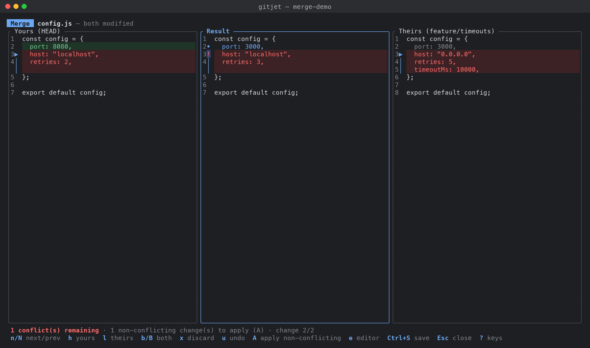

[← Back to docs index](README.md)

# Conflicts and merge resolver

The **Conflicts** tab (tab `6`) lists every file in conflict and controls the operation that
stopped on them: a merge, rebase, cherry-pick, revert or patch application (`git am`). From there
the **3-way merge resolver** opens for a single file, with your version, the result and their
version side by side.

## How conflicts reach you

- When a refresh finds conflicts that were not there before, gitjet switches to the Conflicts tab
  by itself and shows the toast "Conflicts need resolving". This happens after a merge, rebase,
  pull, cherry-pick, revert, stash apply, unshelve or patch that stops on conflicts.
- While conflicts exist, the tab title shows a badge with the number of conflicted files, for
  example `6 Conflicts (2)`, drawn in the conflict color even when another tab is active.
- The status bar shows the repository state (`MERGING`, `REBASING`, `CHERRY-PICKING`,
  `REVERTING`, `APPLYING PATCHES`).

## The Conflicts tab

The top banner describes the operation in progress, for example "Merging feature into main" or
"Rebasing topic onto main (step 2/5) — "subject"", and tells you what to do next. Below it:

- **Conflicts list**: one row per file with its conflict kind and a short note: the number of
  conflict marker blocks left in the work-tree file, `no markers` (the file was already edited),
  or `delete/modify` when one side deleted the file.
- **Details** pane (shown when the terminal is at least 100 columns wide): the conflict kind,
  whether the base, yours and theirs versions exist, and the state of the work-tree file.

Conflict kinds, as reported by Git:

| Kind | Meaning |
|---|---|
| both modified | Both sides changed the file |
| both added | Both sides added a file at this path |
| deleted by us | You deleted the file, they changed it |
| deleted by them | They deleted the file, you changed it |
| added by us | Only your side has the file |
| added by them | Only their side has the file |
| both deleted | Both sides deleted the file |

If files are unmerged but no operation is in progress (for example after applying a stash with
conflicts), the banner says so: resolve the files and mark them resolved; there is nothing to
continue.

## How to resolve a conflict

1. Select the file in the Conflicts tab and press `Enter` (or click a selected row) to open the
   merge resolver.
2. Resolve each change (see below), then press `Ctrl+S` to save. Saving writes the result to the
   work-tree file and stages it, which marks it resolved.
3. When the list is empty, press `C` to continue the operation.

Other ways to resolve a file without the resolver:

- `o` / `t`: take your or their version of the whole file. When that side deleted the file, the
  action is labelled "Accept yours (delete the file)" or "Accept theirs (delete the file)" and the
  file is removed.
- `e`: open the file in your external editor at the first conflict marker, fix it by hand, then
  press `a` to mark it resolved. If the file still contains conflict markers, gitjet asks before
  marking it resolved.
- `d`: resolve by deleting the file from the work tree and the index (asks first).

## How to resolve all files at once

Press `O` (accept yours for all files) or `T` (accept theirs for all files). gitjet asks first,
because the other side's changes in these files are discarded; files deleted on the chosen side
are removed.

## How to continue, skip or abort

| Key | What it does |
|---|---|
| `C` | Continue. Refused while any file is still in conflict. A merge is continued with `git commit --no-edit`; rebase, cherry-pick, revert and `git am` with `--continue`. If the next step stops on new conflicts, the toast says so and the list fills up again. |
| `S` | Skip the current commit (`--skip`), after a confirmation. Available for rebase, cherry-pick, revert and `git am`. A merge cannot skip. |
| `A` | Abort (`--abort`) and return to the state before the operation started, after a confirmation. All resolutions made so far are lost. |

The same three actions are in the action palette, so they work from any tab.

## How to compare the versions

- `v`: diff your version against theirs in the diff viewer.
- Context menu (`.` or `m`): "Show your changes (base → yours)" and "Show their changes
  (base → theirs)".

The versions are exported to `.git/gitjet/conflict-compare/` for the comparison.

## The merge resolver

The resolver is a full-screen dialog with three panes: **Yours (HEAD)** on the left, **Result** in
the middle and **Theirs** on the right. The Theirs title names the incoming side when it is known
(the branch being merged, the commit being picked; for a revert, the parent of the reverted
commit). The header shows the file path and conflict kind, and `● unsaved` once you have changed
something. The status line shows how many conflicts remain, how many non-conflicting changes are
not applied yet, and which change is selected ("change 3/7").

gitjet computes the merge itself, line by line, from the base, yours and theirs versions. Each
changed region is one of:

- changed only on your side, or only on theirs (non-conflicting),
- changed identically on both sides (non-conflicting),
- changed differently on both sides (a conflict).

Line endings are compared without regard to CRLF vs LF, so a file whose sides differ only in line
endings does not conflict. The result is written with the dominant line ending of the inputs.

The resolver opens on the first unresolved conflict. Non-conflicting changes are not applied
automatically: press `A` to apply all of them at once. Until then the
Result pane shows the base text for those regions.

### Resolving changes

| Key | Resolution of the selected change |
|---|---|
| `h` | Accept yours |
| `l` | Accept theirs |
| `b` | Accept both, yours first |
| `B` | Accept both, theirs first |
| `x` | Discard both changes and keep the base text |
| `u` | Undo the resolution of this change |
| `H` / `L` | Accept yours / theirs for every change in the file |
| `A` | Apply all non-conflicting changes |
| `R` | Reset: clear every resolution (asks first) |

Move between changes with `n` / `N` (next / previous unresolved change) and `Tab` / `]` and
`Shift+Tab` / `[` (next / previous change, resolved or not).

### Editing the result as text

- `e` writes the current result to the work-tree file, with conflict markers for unresolved
  conflicts, and opens it in your external editor. When you return, the file is loaded as the
  result. If the work-tree file contains content the resolver did not write (hand edits), a menu
  asks whether to "Replace it with the resolver's result, then edit", "Edit the work-tree file as
  it is (keep its content)" or "Cancel".
- `W` uses the current work-tree file as the result. If you open the resolver on a file that no
  longer has conflict markers, a notice suggests this.

While the result is edited text, the per-change keys are disabled; the Result pane marks lines
inside remaining conflict markers, and `n` / `N` jump between the markers. Press `R` to drop the
text edits and return to the change-by-change view.

The markers gitjet writes use the labels `HEAD` and the incoming side's name, and include the base
section when `merge.conflictStyle` is `diff3` or `zdiff3` in your Git config.

### Saving

`Ctrl+S` saves the result and marks the file resolved when everything is resolved. Otherwise a menu
offers the choices that apply:

- "Apply non-conflicting changes, save and mark resolved" (only when no conflict is left)
- "Save as shown and mark resolved (base text kept)"
- "Save with conflict markers (file stays unresolved)" (only when conflicts are left)
- "Cancel"

For an edited text result that still contains conflict markers, the menu offers "Save and mark
resolved anyway", "Save, keep the file unresolved" and "Cancel".

`Esc` closes the resolver. If you changed something and did not save, gitjet asks before
discarding it. Edits made in the external editor stay in the work-tree file, but the file is not
marked resolved.

### Binary files and delete/modify conflicts

Binary files cannot be merged line by line, and a file that one side deleted has nothing to merge.
For these the resolver shows a **Choose a version** screen with the size of each version (or
"deleted"):

| Key | Action |
|---|---|
| `h` or `o` | Accept yours (keep yours, or delete the file if yours is deleted) |
| `l` or `t` | Accept theirs (keep theirs, or delete the file if theirs is deleted) |
| `?` | Show the keys |
| `Esc` or `q` | Close |

For delete/modify conflicts the screen also previews the first lines of the surviving version.

## Keys

### Conflicts tab

| Key | Action |
|---|---|
| `Enter` | Open the 3-way merge resolver |
| `o` | Accept yours for the selected file |
| `t` | Accept theirs for the selected file |
| `a` | Mark as resolved (asks first if conflict markers remain) |
| `e` | Open in the external editor at the first conflict marker |
| `v` | Compare yours with theirs |
| `d` | Resolve by deleting the file (asks first) |
| `H` | Show the Git history of the file |
| `L` | Show the local history of the file |
| `O` | Accept yours for all files (asks first) |
| `T` | Accept theirs for all files (asks first) |
| `C` | Continue the operation |
| `S` | Skip the current commit (not for merges) |
| `A` | Abort the operation (asks first) |
| `.` or `m` | Context menu |
| `/` | Filter the list by path; `Enter`, `↑` or `↓` ends editing, `Esc` clears it |
| `Esc` | Clear the filter |
| `↓` / `j`, `↑` / `k` | Move |
| `PgDn` / `PgUp` | Page down / up |
| `Home` / `g`, `End` / `G` | First / last file |
| Mouse click | Select a file; click the selected file again to open the resolver |

### Conflicts context menu

With a file selected: "Merge… (3-way resolver)" `Enter`, "Accept yours" `o`, "Accept theirs" `t`,
"Mark as resolved" `a`, "Open in external editor" `e`, "Compare yours with theirs" `v`,
"Show your changes (base → yours)" `y`, "Show their changes (base → theirs)" `i`,
"Resolve by deleting the file…" `d`, "Show history" `H`, "Show local history" `L`.

Always: "Accept yours for all files…" `O`, "Accept theirs for all files…" `T`,
"Continue *operation*" `C`, "Skip this commit…" `S`, "Abort *operation*…" `A` (the operation name,
such as "merge" or "rebase", is filled in; items that do not apply are disabled).

### Merge resolver (text)

| Key | Action |
|---|---|
| `n` / `N` | Next / previous unresolved change |
| `Tab` or `]` | Next change |
| `Shift+Tab` or `[` | Previous change |
| `h` | Accept yours for this change |
| `l` | Accept theirs for this change |
| `b` | Accept both (yours, then theirs) |
| `B` | Accept both (theirs, then yours) |
| `x` | Discard both (keep base) |
| `u` | Undo this change's resolution |
| `A` | Apply all non-conflicting changes |
| `H` / `L` | Accept yours / theirs for every change |
| `R` | Reset: drop text edits, or clear all resolutions (asks first) |
| `e` | Edit the result in the external editor (asks before replacing hand edits) |
| `W` | Use the work-tree file as the result |
| `j` / `↓`, `k` / `↑` | Scroll one line |
| `PgDn` or `Space`, `PgUp` | Scroll one page |
| `Ctrl+D` / `Ctrl+U` | Scroll half a page |
| `Home` / `g`, `End` / `G` | Top / bottom |
| `←` / `→` | Scroll sideways |
| `Ctrl+S` | Save and mark resolved |
| `?` | Show the resolver keys |
| `Esc` | Close (asks first if there are unsaved changes) |

### Merge resolver (choice)

| Key | Action |
|---|---|
| `h` or `o` | Accept yours |
| `l` or `t` | Accept theirs |
| `?` | Show the keys |
| `Esc` or `q` | Close |

## Action palette

Press `:` and type to find these entries:

- `Resolve conflicts…` (switches to the Conflicts tab; with exactly one conflicted file it also
  opens the resolver)
- `Continue operation`
- `Abort operation`
- `Skip commit (rebase / cherry-pick / am)…`
- `Accept all ours…`
- `Accept all theirs…`

## See also

- [Branches and remotes](branches-and-remotes.md) for merge, rebase and pull.
- [Interactive rebase](interactive-rebase.md).
- [Stash, shelf and patches](stash-shelf-patches.md): applying a stash, unshelving or applying a
  patch can also stop on conflicts.
- [Keyboard reference](keyboard-reference.md).
