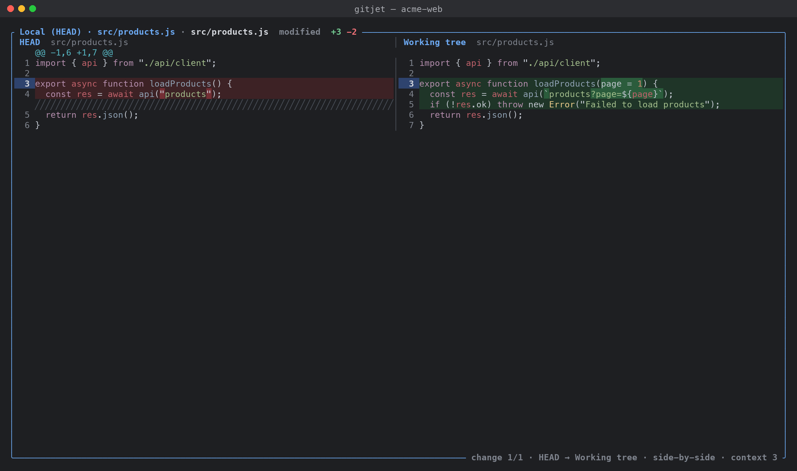

[← Back to docs index](README.md)

# Diff viewer

The **diff viewer** opens fullscreen on top of the current tab whenever you look at a change: a commit in the [Log](log.md), a file in
[Changes](changes-and-commit.md), a stash or shelf entry, a branch comparison, and the comparison
actions in the `:` action palette. It shows a file list on the left and the diff of the selected
file on the right, in unified or side-by-side layout.

## Layout

- **File list** (left). Shown when the diff contains more than one file. Each row has a change
  letter, the file name, its directory (dimmed) and the `+added -removed` line counts (`bin` for
  binary files). The title shows `Files <shown>/<total>`.
- **Diff pane** (right). The title shows the file path (`old → new` for renames and copies), the
  kind of change and the line counts.
- **Status line** at the bottom of the diff pane: the current change (`change 2/5`), the current
  file (`file 1/3`), the two sides being compared, the layout (`unified` or `side-by-side`), the
  context (`context 3` or `whole file`), `whitespace ignored` when that option is on, and the
  horizontal scroll column when scrolled sideways.

The sides are labeled as follows:

| What you are viewing | Left side | Right side |
|---|---|---|
| Unstaged changes | `Index` | `Working tree` |
| Staged changes | `HEAD` | `Index` |
| All local changes | `HEAD` | `Working tree` |
| A commit | the commit's parent (`<hash>^`) | the commit |
| A range | the first revision | the second revision |
| A revision against the work tree | the revision | `Working tree` |
| A stash | `Stash base` | `stash@{n}` |
| Two files | the first file's name | the second file's name |
| Shelf, patches and other prepared diffs | `Before` | `After` |

In side-by-side mode each side has a header with its label and the file path (`(none)` for a side
where the file does not exist).

## How to

### Move between changes and files

1. Press `n` (or `F7`) to jump to the next change block, `N` (or `Shift+F7`) for the previous one.
   At the end of a file these keys continue into the next (or previous) file that has changes.
2. Press `]` and `[` to go to the next and previous file.
3. Use `j`/`k` or the arrow keys to move the caret line by line, `PgUp`/`PgDn` (or `Space`) to
   page, `Ctrl+D`/`Ctrl+U` for half a page, and `g`/`G` (or `Home`/`End`) for the top and bottom.
4. Use `←`/`→` to scroll long lines sideways.

### Switch the layout and highlighting

- `s` switches between unified and side-by-side. The caret stays on the same line.
- `w` turns word-level highlighting on or off.
- `h` turns syntax highlighting on or off.

### Change what the diff includes

- `W` toggles ignoring whitespace (`git diff --ignore-all-space`). When a diff only differs in
  whitespace, the pane says so and tells you to press `W` to show the changes again.
- `+` (or `=`) adds one line of context, `-` removes one (from 0 up to 1000).
- `e` shows whole files instead of only the changed parts; press it again to show changes only.

These three options regenerate the diff with Git, so they are not available for diffs that were
already prepared (shelf entries, patches and similar). gitjet then shows
"Not available for this diff".

### Filter the file list

1. Press `/`. The file list opens and gets a filter field.
2. Type part of a path. Matching is fuzzy (the typed characters must appear in order).
3. Press `Enter` to keep the filter and return to the list, or `Esc` to clear it.
   While typing, `↑`/`↓` move through the matching files.

Press `f` to hide or show the file list, and `Tab` to move focus between the list and the diff.

### Open the file in your editor

Press `Enter` in the diff pane, or `o` / `F4` anywhere in the viewer. gitjet leaves the terminal
UI, opens the work-tree file in your editor and returns when the editor exits. For `vi`, `vim`,
`nvim`, `nano`, `emacs`, `hx`, `micro` and `kak` the editor opens at the line under the caret.
The editor is the `editor` setting, then `$VISUAL`, then `$EDITOR`, then `notepad` on Windows and
`vi` elsewhere (see [Configuration](configuration.md)). Deleted files cannot be opened.

### Jump to blame and history

- `b` opens [Annotate (blame)](files-blame-history.md) for the file: at the revision shown on the
  right side, or the left side for a deleted file. When that side does not have the file, `HEAD`
  is used if it does.
- `H` opens the file's Git history.
- `L` opens the file's [Local history](local-history.md).

These are not available when comparing two arbitrary files.

### Compare with a branch, tag or revision

1. Press `:` and run **Compare with branch or revision…**.
2. Type to filter the list of local branches, remote branches and tags (most recently updated
   first within each group). The first row always compares with exactly what you typed, so any
   revision expression works (`HEAD~3`, a hash, `v1.2^{}`). With nothing typed, the first row
   opens a separate input dialog for a revision.
3. Press `Enter`, then pick what to compare:

| Item | Key | Shows |
|---|---|---|
| Working tree vs `<rev>` | `w` | the revision against your work tree |
| Changes on `<rev>` since it diverged from `<current branch>` | `b` | what the revision adds since the merge base |
| Changes on `<current branch>` since it diverged from `<rev>` | `c` | what your branch adds since the merge base |
| `<current branch>` vs `<rev>` (direct) | `d` | a direct diff from `HEAD` to the revision |

The last three need at least one commit on the current branch.

### Compare two files

1. Press `:` and run **Compare two files…**.
2. Enter the first file, then the second. A path can be relative to the repository root, absolute,
   or start with `~/`. Surrounding quotes are removed. If a path does not exist, the dialog stays
   open with an error.

### Show local changes

From the `:` palette:

- **Show all local changes**: staged, unstaged and untracked changes against `HEAD`.
- **Show staged changes**: index against `HEAD`.
- **Show unstaged changes**: work tree against the index, including untracked files.

Each shows a short message instead when there is nothing to show.

## Keys

### Anywhere in the viewer

| Key | Action |
|---|---|
| `n`, `F7` | Next change (continues into the next file) |
| `N`, `Shift+F7` | Previous change (continues into the previous file) |
| `]` | Next file |
| `[` | Previous file |
| `s` | Toggle unified / side-by-side |
| `w` | Toggle word-level highlighting |
| `h` | Toggle syntax highlighting |
| `W` | Toggle ignore whitespace |
| `+`, `=` | More context lines |
| `-` | Fewer context lines |
| `e` | Toggle whole file / changes only |
| `f` | Show / hide the file list |
| `r`, `F5` | Reload the diff |
| `Tab`, `Shift+Tab` | Switch focus between file list and diff |
| `/` | Filter the file list (only with more than one file) |
| `o`, `F4` | Open the file in your editor at the caret line |
| `b` | Annotate (blame) |
| `H` | File history |
| `L` | Local history |
| `.`, `m` | Diff actions menu |
| `Esc` | Clear the file filter; if there is none, close the viewer |
| `q` | Close the viewer |

### Diff pane

| Key | Action |
|---|---|
| `j`, `↓` | Next line |
| `k`, `↑` | Previous line |
| `Ctrl+D` | Half a page down |
| `Ctrl+U` | Half a page up |
| `PgDn`, `Space` | Page down |
| `PgUp` | Page up |
| `g`, `Home` | Top (also resets horizontal scroll) |
| `G`, `End` | Bottom |
| `←` / `→` | Scroll sideways by 8 columns |
| `Enter` | Open the file in your editor at this line |

### File list (when focused)

| Key | Action |
|---|---|
| `j`, `↓` | Next file |
| `k`, `↑` | Previous file |
| `PgDn` / `PgUp` | Page down / up |
| `g`, `Home` | First file |
| `G`, `End` | Last file |
| `Enter`, `→`, `l` | Focus the diff |

### File filter field

| Key | Action |
|---|---|
| type | Filter the files (fuzzy) |
| `↑` / `↓` | Previous / next matching file |
| `Enter` | Keep the filter and leave the field |
| `Esc` | Clear the filter and leave the field |

### Mouse

- Click a file in the list to show it.
- Click a line in the diff to put the caret there.
- The scroll wheel moves through the focused pane; scrolling over the diff gives it focus.

### Diff actions menu (`.` or `m`)

| Item | Key |
|---|---|
| Next difference | `n` |
| Previous difference | `N` |
| Next file | `]` |
| Previous file | `[` |
| Side-by-side view / Unified view | `s` |
| Word-level highlighting (on/off) | `w` |
| Syntax highlighting (on/off) | `h` |
| Ignore whitespace (on/off) | `W` |
| More context (N lines) | `+` |
| Less context | `-` |
| Show whole file / Show changes only | `e` |
| Hide file list / Show file list | `f` |
| Reload | `r` |
| Open in editor | `o` |
| Annotate (blame) | `b` |
| Show file history | `H` |
| Show local history | `L` |

In any menu, `↑`/`↓` (or `j`/`k`) and `Enter` run an item, the key on the right runs it directly,
and `Esc` or `q` closes the menu.

### Compare with branch or revision (chooser)

| Key | Action |
|---|---|
| type | Filter the refs, or enter a revision |
| `↑` / `↓` | Move |
| `PgUp` / `PgDn` | Move by 10 |
| `Enter` | Compare with the selected ref or the typed revision |
| `Esc` | Close |

## Settings

The viewer starts with the values from the `[diff]` section of the config file. Keys pressed in
the viewer change only the open viewer.

| Setting | Default | Effect |
|---|---|---|
| `diff.side_by_side` | `false` | Start in side-by-side layout |
| `diff.context_lines` | `3` | Context lines around each change |
| `diff.ignore_whitespace` | `false` | Start with whitespace ignored |
| `diff.word_diff` | `true` | Word-level highlighting |
| `diff.syntax_highlight` | `true` | Syntax highlighting |

`word_diff` and `syntax_highlight` also apply to the inline diff previews in other tabs. See
[Configuration](configuration.md).

Renames are detected (`-M`). Very long lines are not syntax highlighted, so minified files stay
fast.

## Action palette

- Compare with branch or revision…
- Compare two files…
- Show all local changes
- Show staged changes
- Show unstaged changes
