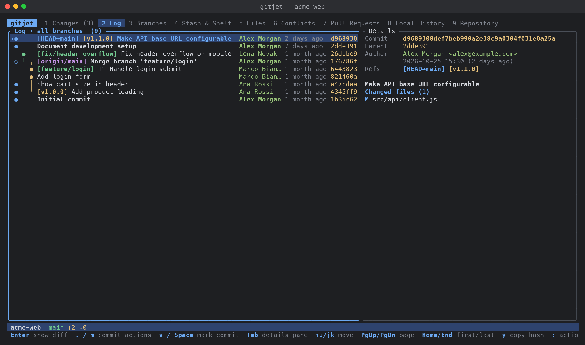

[← Back to docs index](README.md)

# Log

The **Log** tab (key `2`) shows the commit graph with branch and tag labels, filters for branch, user, date, path and
text, a details pane for the selected commit, and the history operations: checkout, cherry-pick,
revert, reset, undo commit, edit message, new branch or tag here, interactive rebase and
comparisons.

## Layout

- **Commit list.** Each row has, from left to right:
  - a marker column: `▌` for a marked commit, `›` for `HEAD`;
  - the commit graph, drawn with box-drawing characters, one color per lane (the graph never takes
    more than a third of the row);
  - ref labels (`HEAD` first, then local branches, remote branches and tags) and the subject;
  - the author (in bold for your own commits, matched on `user.email`);
  - the date (relative, such as `3 hours ago`, or absolute `2026-10-27 14:03`; press `t` to switch);
  - the short hash.

  On narrow terminals the author column is dropped first, then the date, then the hash.
- **Panel title.** Shows the active branch choice and filters (for example
  `Log · all branches · user: me · path: src  (500+)`). The count ends in `+` while more commits
  can be loaded. The title also shows how many commits are marked and `loading…` while a page loads.
- **Details pane.** To the right of the list when the terminal is at least 100 columns wide,
  below it otherwise. Press `D` to hide or show it.

### Details pane

For the selected commit the details pane shows:

- `Commit`: the full hash.
- `Parent` / `Parents`: abbreviated parent hashes, or `(root commit)`.
- `Author` with email, and the author date.
- `Committer` and commit date, only when they differ from the author.
- `Refs`: the branch and tag labels.
- The full commit message (subject in bold). Press `PgUp`/`PgDn` with the details pane focused to
  scroll a long message.
- `Changed files (N)`: one line per file with its status letter (`A`, `M`, `D`, `R`, `C`...) and,
  for renames, the old path (`← old`). Merge commits are listed against their first parent. At
  most 5000 files are listed (`5000+`).

Details load in the background, so very large commits do not freeze the UI.

### Loading

Commits load in pages of `log.page_size` commits (default 500, allowed range 50 to 10000). When
the selection gets within 50 commits of the end of the loaded list, the next page loads
automatically. A refresh reloads as many commits as are loaded, up to 20000.

By default the log shows all branches, remote branches and tags (`git log --all`, without the
stash). Set `log.all_branches = false` to start with only `HEAD`. Press `a` to switch between the
two at any time. See [Configuration](configuration.md).

## How to

### Look at a commit

1. Move to the commit with `j`/`k`, `PgUp`/`PgDn` or `Home`/`End`.
2. Press `Enter` (or double-click the row) to open the full commit diff in the
   [Diff viewer](diff-viewer.md).
3. Press `Tab` to move into the details pane, select a file with `j`/`k`, and press `Enter` (or
   double-click) to see only that file's diff.

### Jump to a commit, branch or tag

1. Press `g`.
2. Enter a commit hash (or a prefix), a branch, a tag or a revision such as `HEAD~3`.
3. If the commit is already loaded, it is selected. Otherwise the log is reloaded starting at that
   commit. Filters that could hide it (user, text, date, path, no merges) are cleared, and a note
   under the list tells you. Press `a` to return to all branches or `F` to reset the filters.

### Filter the log

Press `/` to filter by text quickly, or `f` for the filter menu:

| Item | Key | What it does |
|---|---|---|
| Branch: … | `b` | Pick `All branches`, `HEAD (current branch)`, or one local branch, remote branch or tag (type to search) |
| User: … | `u` | Pick `Any user`, `me (<name> <email>)`, `Type a name or email…`, or one of the authors seen in the loaded log, most frequent first |
| Date: … | `d` | Open the date menu (below) |
| Path: … | `p` | Enter one or more files or directories, relative to the repository root, separated by `;` |
| Text: … | `t` | Enter text to search for |
| Search text in: commit messages / diff content (-S) | `s` | Switch what the text filter searches |
| First-parent only: on/off | `F` | Follow only first parents (`--first-parent`) |
| No merges: on/off | `n` | Hide merge commits (`--no-merges`) |
| Clear all filters | `x` | Remove every filter |

Date menu:

| Item | Key |
|---|---|
| Last 24 hours | `1` |
| Last 7 days | `7` |
| Last 30 days | `3` |
| Last year | `y` |
| Since… | `s` |
| Until… | `u` |
| Any date | `x` |

**Since…** and **Until…** accept any date Git understands, such as `2 weeks ago`, `yesterday` or
`2024-01-31`.

How the filters match:

- **User** matches the text as a fixed string, ignoring case, against `name <email>`. Typing `me`
  uses your `user.email`. An empty value clears the filter.
- **Text** in commit-message mode matches the message as a fixed string, ignoring case
  (`git log --grep`). In diff-content mode it finds commits that add or remove the text
  (`git log -S`).
- **Path** shows commits that touch the paths. The graph connects these commits directly, while
  actions such as "Compare with previous" and revert still use the real parents.
- Leaving any input empty clears that filter.

Press `F` in the log to clear all filters. Clearing keeps your all-branches or `HEAD` default.

### Mark several commits

Press `v` or `Space` to mark the selected commit; the selection moves to the next one. Press
`Esc` to clear all marks. With commits marked, the commit menu acts on the marked commits:

- **Copy N hashes** copies all marked hashes, separated by spaces.
- **Cherry-pick N commits** applies them oldest first.
- **Revert N commits** reverts them newest first.
- **Compare the two marked commits** (only with exactly two marked) diffs the older one against
  the newer one.

### Cherry-pick

1. Select a commit (or mark several) and press `.` or `m`, then `p`.
2. gitjet cherry-picks in the background. Merge commits are picked against their first parent.
   Commits whose changes are already on your branch are skipped, and the message says how many.
3. If a pick stops on conflicts, gitjet switches to the [Conflicts](conflicts.md) tab, where you
   resolve them and continue or abort.

From anywhere, the palette entry **Cherry-pick…** takes one or more revisions separated by
spaces, oldest first.

### Revert a commit

Press `.` then `r`. gitjet creates a revert commit with Git's default message
(`git revert --no-edit`). Merge commits are reverted against their first parent. Conflicts go to
the [Conflicts](conflicts.md) tab. The palette entry **Revert…** takes revisions separated by
spaces.

### Reset the current branch to a commit

1. Select the commit, press `.` then `R` (**Reset current branch to here…**).
2. Pick a mode:

| Mode | Key | Meaning |
|---|---|---|
| Soft | `s` | keep changes staged |
| Mixed | `m` | keep changes in the work tree, unstaged |
| Hard | `h` | discard all changes |
| Keep | `K` | discard commits, keep local changes |

A hard reset asks for confirmation first, because it cannot be undone. The palette entry
**Reset HEAD…** asks for a revision (default `HEAD~1`) and then shows the same menu.

### Undo the last commit

Select the `HEAD` commit, press `.` then `u`, or run **Undo last commit** from the palette. The
commit is removed and its changes stay staged (a soft reset to `HEAD~1`). Undoing the very first
commit of a branch works too. If the commit was already pushed, gitjet names the remote branches
and asks first, because the branch will need a force push.

### Edit a commit message

Select a commit on the current branch, press `.` then `e`.

- For `HEAD`, an editor opens with the current message. Press `Ctrl+S` (or `Alt+Enter`) to save,
  `Esc` to cancel. The first line turns to the warning color when it is longer than
  `commit.subject_limit`. Only the message changes; staged changes are not added to the commit.
  When the commit was already pushed, the title says it needs a force push.
- For an older commit, gitjet opens the [interactive rebase](interactive-rebase.md) editor
  starting at that commit.

If the log cannot tell whether the commit is on the current branch (because filters hide
commits), gitjet checks when you pick the action and shows an error if it is not.

### Interactively rebase from a commit

Select a commit on the current branch, press `.` then `i`. The
[interactive rebase](interactive-rebase.md) editor opens with that commit and everything after it
up to `HEAD`. For a root commit the whole history is included.

### Create a branch or tag at a commit

- `.` then `b` (**New branch here…**): enter a name. The new branch is checked out right away.
- `.` then `t` (**New tag here…**): enter a name, then a message. A message creates an annotated
  tag; leave it empty for a lightweight tag.

### Check out a commit

Press `.` then `o` (**Checkout revision (detached HEAD)…**) and confirm. New commits made there
belong to no branch unless you create one.

### Compare

From the commit menu:

- **Show diff** (`d`): the commit against its first parent.
- **Compare with previous** (`P`): the first parent against the commit as a range (not available
  for root commits).
- **Compare with local** (`l`): the commit against your work tree.

From the details pane, `l` compares the selected file at that commit with the work tree.

### Copy a hash or path

Press `y` in the list to copy the full hash of the selected commit, or `y` in the details pane to
copy the selected file's path. gitjet copies through the OSC 52 terminal escape sequence, which
works over SSH and is supported by Windows Terminal, iTerm2, kitty, WezTerm, Alacritty, foot and
others (in tmux, enable `set-clipboard on`). A message shows what was copied.

## Keys

### Both panes

| Key | Action |
|---|---|
| `/` | Filter by text |
| `f` | Filter menu |
| `F` | Clear all filters |
| `a` | Switch between all branches and `HEAD` |
| `g` | Go to a hash, branch, tag or revision |
| `t` | Switch between relative and absolute dates |
| `D` | Show / hide the details pane |

### Commit list

| Key | Action |
|---|---|
| `j`, `↓` | Next commit |
| `k`, `↑` | Previous commit |
| `PgDn` / `PgUp` | Page down / up |
| `Home` / `End` | First / last loaded commit |
| `Enter` | Show the commit diff |
| `v`, `Space` | Mark / unmark the commit and move down |
| `Esc` | Clear marks |
| `y` | Copy the full hash |
| `.`, `m` | Commit menu |
| `Tab`, `Shift+Tab` | Focus the details pane (shows it if hidden) |

### Details pane

| Key | Action |
|---|---|
| `j`, `↓` | Next file |
| `k`, `↑` | Previous file |
| `Home` / `End` | First / last file |
| `PgDn` / `PgUp` | Scroll the commit message |
| `Enter` | Diff of the selected file in this commit |
| `d` | Diff of the whole commit |
| `b` | Annotate (blame) the file at this revision (in the parent for a deleted file) |
| `h` | Git history of the file |
| `l` | Compare the file at this commit with the work tree |
| `y` | Copy the file path |
| `.`, `m` | File menu |
| `Tab`, `Shift+Tab`, `Esc` | Back to the commit list |

### Mouse

- Click a commit to select it; double-click to show its diff.
- Click a file in the details pane to select it; double-click to show its diff.

### Commit menu (`.` or `m` in the list)

| Item | Key | Notes |
|---|---|---|
| Copy revision hash / Copy N hashes | `c` | Full hashes |
| Checkout revision (detached HEAD)… | `o` | Asks for confirmation |
| New branch here… | `b` | Checks the branch out |
| New tag here… | `t` | Annotated when a message is given |
| Cherry-pick / Cherry-pick N commits | `p` | Marked commits apply oldest first |
| Revert commit / Revert N commits | `r` | Marked commits revert newest first |
| Reset current branch to here… | `R` | Soft, Mixed, Hard or Keep |
| Undo last commit | `u` | Only on `HEAD` |
| Edit commit message… | `e` | Only on the current branch |
| Interactively rebase from here… | `i` | Only on the current branch |
| Show diff | `d` | |
| Compare with previous | `P` | Not for root commits |
| Compare with local | `l` | |
| Compare the two marked commits | `C` | Only with exactly two marked |
| Mark / unmark | `v` | |
| Show only commits by `<author>` | `a` | Sets the user filter |

Disabled items are shown dimmed.

### File menu (`.` or `m` in the details pane)

| Item | Key |
|---|---|
| Show diff | `d` |
| Compare with local | `l` |
| Annotate (blame) at this revision | `b` |
| Show history | `h` |
| Copy path | `c` |

### Reset menu

| Item | Key |
|---|---|
| Soft: keep changes staged | `s` |
| Mixed: keep changes in the work tree, unstaged | `m` |
| Hard: discard all changes (asks for confirmation) | `h` |
| Keep: discard commits, keep local changes | `K` |

### Filter menus and inputs

The filter menu (`f`), date menu and reset menu are menus: use `↑`/`↓` (or `j`/`k`) and `Enter`,
or press the key shown next to an item. `Esc` or `q` closes them.

The branch and user pickers are searchable: type to narrow the list, `↑`/`↓` and `PgUp`/`PgDn` to
move, `Enter` to pick, `Esc` to close.

Text inputs (go to, text, path, user, dates, branch and tag names) accept `Enter` to apply and
`Esc` to cancel. The commit message editor uses `Ctrl+S` or `Alt+Enter` to save and `Esc` to
cancel.

## Action palette

- Go to commit…
- Undo last commit
- Reset HEAD…
- Cherry-pick…
- Revert…
- Filter log by user…
- Filter log by branch…
- Filter log by path…
- Toggle all branches in log
