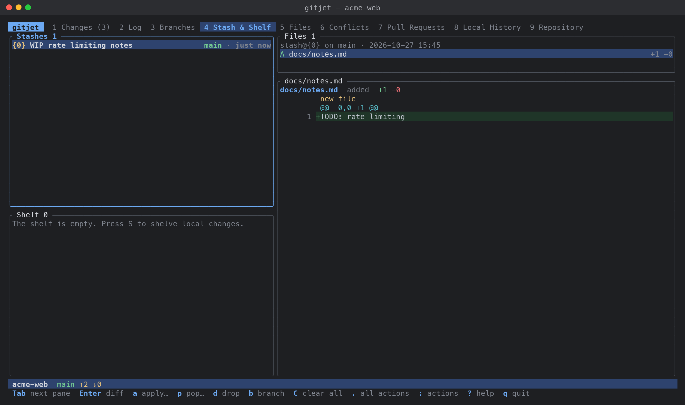

[← Back to docs index](README.md)

# Stash, shelf and patches

The **Stash & Shelf** tab (tab `4`) puts Git stashes, the shelf and patch files in one
place: stash and unstash changes, shelve and unshelve them, and create and apply patches.

## Stash or shelf?

| | Stash | Shelf |
|---|---|---|
| Stored as | Git stash commits (`refs/stash`) | Files in `.git/gitjet/shelf/` |
| Takes | All local changes | The files you pick |
| Partial restore | No (whole stash) | Yes, file by file |
| After restoring | Dropped on pop, kept on apply | Kept as "unshelved" until you clean it up |
| Visible to other Git tools | Yes | No |

## Layout

- **Stashes** (top left): `stash@{N}` entries with their message, branch and age.
- **Shelf** (bottom left): shelf entries with their name, file count and how many files were
  already unshelved (`2/5 unshelved`, or `✓ unshelved` when all were).
- **Files** (right): the files of the selected stash or shelf entry, with a status letter and
  `+`/`-` line counts. `?` marks untracked files. An info line shows the entry's branch, age, and
  whether it includes untracked files.
- **Diff** (right, below Files): the diff of the selected file.

`Tab` / `Shift+Tab` cycle through the four panes. The list you used last (Stashes or Shelf)
drives the Files and Diff panes.

## How to stash changes

1. Press `s` (works in every pane).
2. In the **Stash Changes** dialog, type an optional message.
3. Set the options:
   - "Include untracked files" (`Alt+u`, on by default)
   - "Keep index (leave staged changes in place)" (`Alt+i`, off by default)
4. Press `Enter`.

The stash always covers all local changes. A repository without commits cannot be stashed.

## How to apply or pop a stash

1. Select the stash in the Stashes pane.
2. Press `a` (apply) or `p` (pop). Both open the same dialog with two options:
   - "Pop (drop the stash after applying)" (`p`), preset to match the key you pressed
   - "Restore index (reinstate staged changes)" (`r`, runs `git stash apply --index`)
3. Press `Enter`.

If the stash conflicts with your work tree, gitjet switches to the
[Conflicts tab](conflicts.md). On conflicts Git keeps the stash even when you chose pop.

The palette entry "Unstash (pop latest)" pops `stash@{0}` without a dialog.

Before applying, popping, dropping or branching, gitjet checks that `stash@{N}` is still the stash
you selected, so a stash list changed by another tool does not make it act on the wrong entry.

## How to manage stashes

- `Enter`: show the whole stash in the [diff viewer](diff-viewer.md).
- `d`: drop the stash (asks first).
- `b`: create a branch from the stash (`git stash branch`). The name defaults to
  `<branch>-stash`. This checks out a new branch at the stash's base commit, applies the stash and
  drops it.
- `C`: clear all stashes (asks first).

## How to shelve changes

1. Press `S` to shelve all local changes, or press `s` on a selection in the
   [Changes tab](changes-and-commit.md) to shelve just those files.
2. In the **Shelve Changes** dialog:
   - Name: defaults to `Changes YYYY-MM-DD HH:MM` and must not be empty.
   - Files: a checklist of the changed files, all checked. `Space` toggles one, `a` toggles all.
   - "Keep changes in the work tree" (`w`, off by default).
3. Press `Enter`.

Unless you keep the changes, gitjet then reverts the shelved files: tracked files are restored
from `HEAD`, new and untracked files are deleted. Files with unresolved conflicts cannot be shelved.

Each shelf entry is a directory `.git/gitjet/shelf/<id>/` that contains:

- `meta.json`: the name, creation time, file list with status letters, the branch and `HEAD`
  commit at shelve time, and which files were unshelved;
- `changes.patch`: a binary-safe diff of the tracked files against `HEAD`;
- `untracked/<path>`: copies of the untracked files.

## How to unshelve

Whole entry or a chosen set of files:

1. Select the entry in the Shelf pane and press `u`.
2. The **Unshelve** dialog lists every file of the entry; files not yet unshelved are checked.
   Files already unshelved are labelled `(unshelved)`.
3. Adjust the checklist and press `Enter`.

Single files from the Files pane:

1. Select the entry, press `l` or `→` to move to its files.
2. Press `Space` to mark files (the selection moves down after each mark), or select just one.
3. Press `u` to unshelve the marked files, or the selected file when none are marked.

The patch part is applied with a 3-way merge fallback, so it may leave conflicts; gitjet then
switches to the [Conflicts tab](conflicts.md). When an untracked copy would overwrite an existing,
different file, a menu asks: "Overwrite existing files", "Skip existing files" or "Cancel".

Unshelving does not delete the entry. Once every file is unshelved, the entry stays on the shelf
marked `✓ unshelved`. Press `D` to delete all such entries at
once.

The palette entry "Unshelve…" lets you pick an entry from a filterable list first.

## How to manage shelf entries

- `Enter`: show the whole entry in the diff viewer.
- `R`: rename.
- `d`: delete (asks first).
- `D`: clean up every entry that was already fully unshelved (asks first).
- `x`: export as a patch file (includes the untracked files). The default file name is the entry
  name in lowercase with dashes (for example `changes-2026-10-27-14-03.patch`), in the repository
  root.

## How to create a patch

- From local changes: press `c`. The patch contains every local change (staged, unstaged and
  untracked; ignored files are excluded). The default file name is based on the current branch
  name (`local-changes.patch` on a detached HEAD), in the repository root.
- From a commit: press `F`, enter a revision (hash, branch, tag, `HEAD~2`…; defaults to `HEAD`).
  The patch is `git format-patch` output for that one commit, named after its short hash and
  subject (`<short hash>-<subject>.patch`, subject in lowercase with dashes).

In both cases you are asked for the path. Relative paths are inside the repository and `~` is your
home directory. gitjet asks before overwriting an existing file.

## How to apply a patch

1. Press `P` and enter the path of a `.patch` / `.diff` file or a mailbox from
   `git format-patch`.
2. A preview opens with the patch's files on the left and the selected file's diff on the right.
3. Press `Enter` (or `y`) to apply it, `Esc` to cancel.

What happens depends on the file:

- A plain diff is applied to the work tree with `git apply`; if that fails, gitjet retries with
  `git apply --3way`, which can leave conflicts. The index is left as it was, so the result looks
  like ordinary local changes.
- A mailbox (`git format-patch` output) is applied with `git am --3way`, which creates commits. If
  `git am` stops, the error explains why; resolve the problem and use the palette entries
  "Continue applying patches (git am --continue)", "Skip current patch (git am --skip)" or
  "Abort applying patches (git am --abort)". The [Conflicts tab](conflicts.md) can also continue,
  skip or abort a stopped `git am`.

## Keys

### Stash & Shelf tab: everywhere

| Key | Action |
|---|---|
| `Tab` / `Shift+Tab` | Next / previous pane |
| `Enter` | Show the diff of the selected entry (list panes) or file (Files and Diff panes) in the diff viewer |
| `j` / `↓`, `k` / `↑` | Move (in the Diff pane: scroll) |
| `PgDn` / `PgUp` | Page |
| `Home` / `g`, `End` / `G` | First / last |
| `l` / `→` | From a list pane to the Files pane |
| `h` / `←` | From the Files or Diff pane back to the list |
| `J` / `K` | Scroll the diff one line |
| `Ctrl+D` / `Ctrl+U` | Scroll the diff half a page |
| `/` | Filter the focused list (not in the Diff pane); `Enter`, `Tab`, `↑` or `↓` ends editing, `Esc` clears it |
| `Esc` | In the Files or Diff pane: back to the list; in a list: clear its filter |
| `s` | Stash changes… |
| `S` | Shelve all changes… |
| `c` | Create patch from local changes… |
| `F` | Create patch from commit… |
| `P` | Apply patch… |
| `.` or `m` | Context menu |
| Mouse click | Focus a pane and select the clicked row |

### Stashes pane

These keys also work in the Files and Diff panes while a stash is shown.

| Key | Action |
|---|---|
| `a` | Apply stash… |
| `p` | Pop stash… |
| `d` | Drop stash (asks first) |
| `b` | New branch from stash… |
| `C` | Clear all stashes (asks first) |

### Shelf pane

These keys also work in the Files and Diff panes while a shelf entry is shown, except `u`.

| Key | Action |
|---|---|
| `u` | Unshelve… (file checklist) |
| `R` | Rename… |
| `x` | Export as patch… |
| `d` | Delete (asks first) |
| `D` | Clean up unshelved entries (asks first) |

### Files pane (shelf entry)

| Key | Action |
|---|---|
| `Space` | Mark or unmark the file and move down |
| `u` | Unshelve the marked files, or the selected file (also in the Diff pane) |

### Context menu

For a stash: "Show diff" `Enter`, "Apply stash…" `a`, "Pop stash…" `p`,
"New branch from stash…" `b`, "Drop stash" `d`, "Clear all stashes" `C`.

For a shelf entry: "Show diff" `Enter`, "Unshelve…" `u`, "Unshelve selected file" or
"Unshelve N marked files" `f` (only from the Files and Diff panes), "Rename…" `R`,
"Export as patch…" `x`, "Delete" `d`, "Clean up unshelved entries" `D`.

Always: "Stash changes…" `s`, "Shelve all changes…" `S`, "Create patch from local changes…" `c`,
"Create patch from commit…" `F`, "Apply patch…" `P`.

### Stash, shelve, unshelve and apply-stash dialogs

| Key | Action |
|---|---|
| `Enter` | Confirm |
| `↑` / `↓` | Move between rows |
| `j` / `k` | Move (outside the text field) |
| `PgDn` / `PgUp` | Move by 12 rows (outside the text field) |
| `Tab` / `Shift+Tab` | Next / previous section (text, files, options) |
| `Space` | Toggle the file or option on the current row |
| `a` | Toggle all files (on a file row) |
| `Alt+`*key* | Toggle the option with that key, from anywhere in the dialog |
| *key* | Toggle the option with that key (outside the text field) |
| `Esc` | Cancel |

Option keys: Stash Changes `u` (include untracked), `i` (keep index); Apply / Pop stash `p` (pop),
`r` (restore index); Shelve Changes `w` (keep changes in the work tree).

### Apply patch preview

| Key | Action |
|---|---|
| `Enter` or `y` | Apply the patch |
| `j` / `↓`, `k` / `↑` | Select a file |
| `Home` / `g`, `End` / `G` | First / last file |
| `PgDn` or `Space`, `PgUp` | Scroll the diff a page |
| `J` / `K` | Scroll the diff a line |
| `Esc` or `q` | Cancel |

## Action palette

- `Stash changes…`
- `Unstash (pop latest)`
- `Clear all stashes…`
- `Shelve all changes…`
- `Unshelve…`
- `Create patch from local changes…`
- `Create patch from commit…`
- `Apply patch…`
- `Continue applying patches (git am --continue)`
- `Skip current patch (git am --skip)`
- `Abort applying patches (git am --abort)`

## See also

- [Changes and commit](changes-and-commit.md): shelve or stash from the Changes tab.
- [Conflicts and merge resolver](conflicts.md).
- [Local history](local-history.md): automatic snapshots that do not need a stash or shelf.
- [Keyboard reference](keyboard-reference.md).
